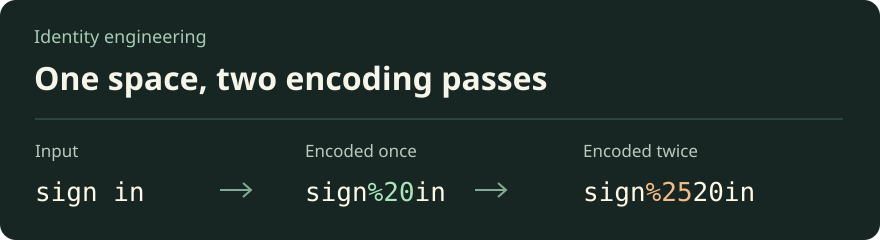

# Hi, I’m Baba Gandhi.

One of the most interesting bugs I worked on at Eventbrite came down to a percent sign. A URL component had already been encoded. Encoding it again changed what the sign-in flow received.

Today I work on backend services and cloud infrastructure at Nasuni. I like problems I can follow end to end, from the request a user makes to the signal an engineer sees when something goes wrong.

**On the research side**, I co-authored a study comparing how text representations affect sentiment classification. We looked at F1, AUC and training time alongside accuracy. [Read the IEEE paper](https://doi.org/10.1109/ETCOM66606.2025.11436537)

[Find me on LinkedIn](https://www.linkedin.com/in/baba-gandhi-kandagatla)
